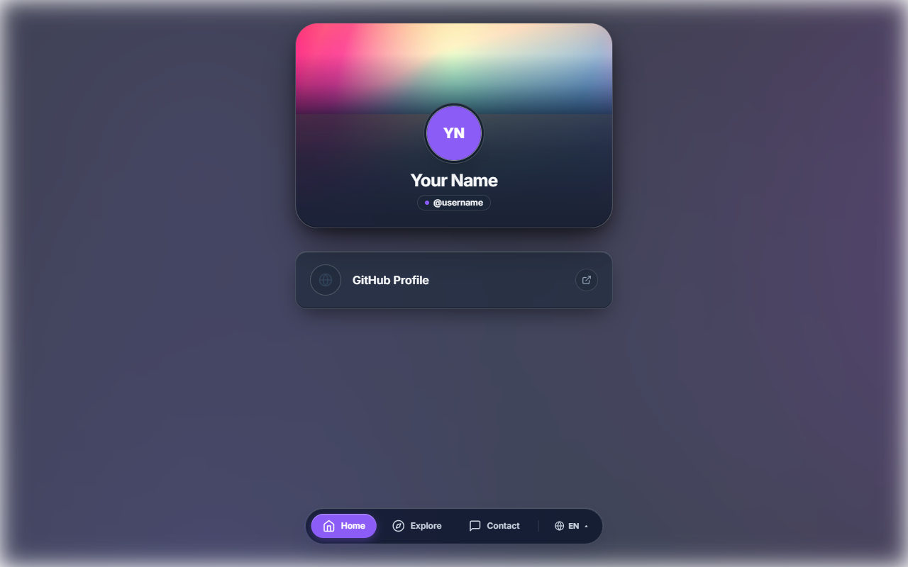
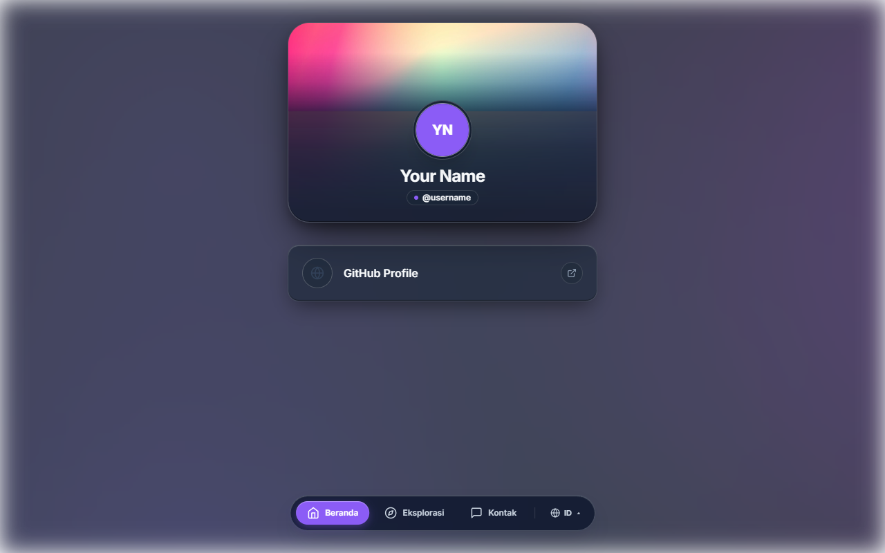
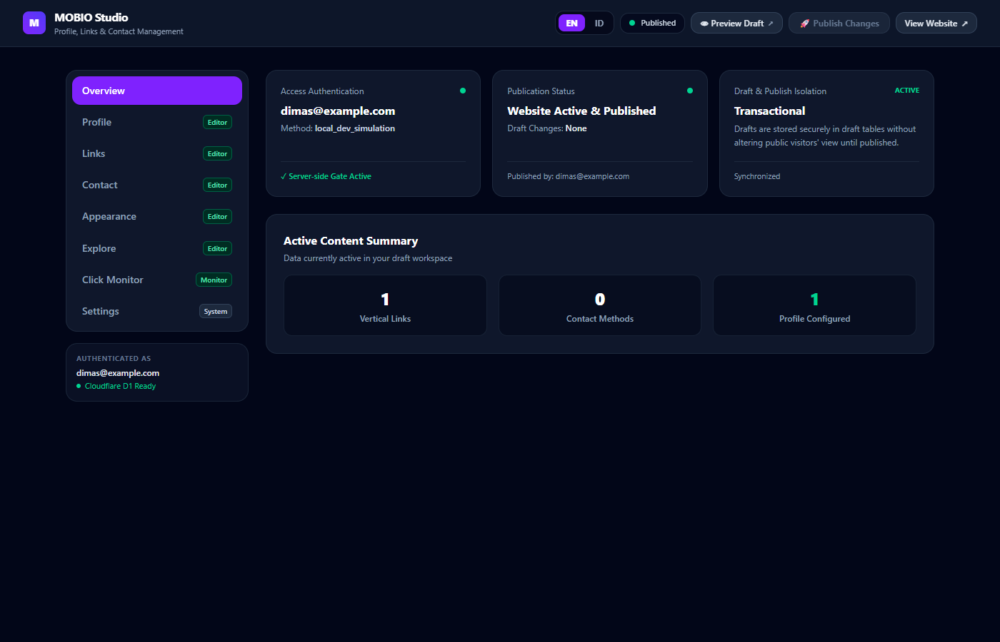
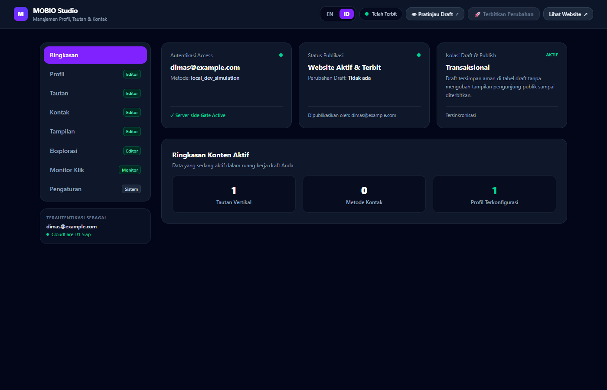
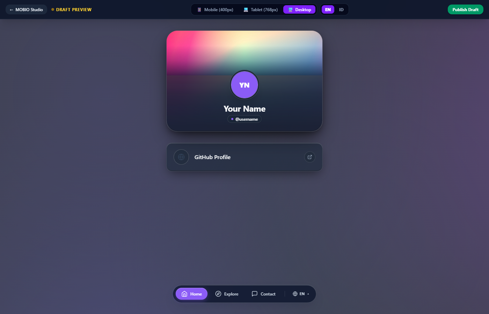

# MOBIO Link Bio

A sovereign, self-hosted personal **Link in Bio** and modular portfolio application built with a **Full Premium Liquid Glass** aesthetic, **React Router v7 Framework Mode (SSR)**, and **Cloudflare Workers**.

---

## 🌟 Overview

**MOBIO Link Bio** is an open-source, independently deployable alternative to closed Link in Bio platforms. It allows creators, engineers, designers, and professionals to host their own modern identity card, link list, modular portfolio, and direct-action contact hub on their personal Cloudflare infrastructure.

Every deployment is **100% sovereign and isolated**: you own your Cloudflare D1 database, your Cloudflare R2 media storage, and your Cloudflare Access Zero Trust administrative guard.

---

## ✨ Features

### 🌐 Full Bilingual System (V4.2)
- **English Default Everywhere:** Unauthenticated visitors, public views, and the entire Studio workspace load in English by default.
- **Dedicated 2-Choice Language Selector:** Seamlessly switch between **English (`EN`)** and **Indonesian (`ID`)** via an accessible popover in the floating dock or the Studio header.
- **Synchronized SSR:** Zero hydration mismatch and zero flash of wrong language via cookie parsing (`mobio_lang`) and client persistence.
- **Dual-Language Content:** Supports localized bios, locations, link titles, contact methods, and explore items with deterministic fallbacks.

### 🎨 Visual & Theme Customization
- **30 Premium Color Themes:** Frost Aurora, Dark Sapphire, Emerald Glass, Violet Neon, Sunset Amber, Rose Quartz, Cyberpunk Slate, and 23 additional calibrated palettes.
- **20 Layout Presets:** Minimal Stack, Neo Capsule, Soft Grid, Split Composition, Compact Center, Magazine Editorial, and 14 other thumb-friendly responsive arrangements.
- **10 Profile Card Styles:** Floating Glass, Immersive Card, Minimalist Monogram, Bordered Glow, Split Header, Pill Minimal, and 4 other variations.
- **3 Profile Card Sizes:** Compact (`sm`), Standard (`md`), Spacious (`lg`).
- **24 Typography Presets:** Organized into Modern Sans, Elegant Serif, Tech Mono, and Expressive Display families with automatic Google Fonts streaming.
- **Liquid Glass Materials:** Specular highlights (`inset 0 1.5px 1px 0 rgba(255, 255, 255, 0.95)`), backdrop filters (`blur(24px) saturate(180%)`), and multi-layer floating drop shadows.
- **Fullscreen Background Engine:** Supports animated CSS gradient mesh, static high-res images, or background videos with automatic pause on tab blur and `prefers-reduced-motion` detection.

### 🔗 Content & Showcase Management
- **Single-Column Vertical Link List:** Clean, thumb-friendly vertical links on all viewports with smooth hover sheens and platform-specific iconography.
- **Custom Icon Library & Uploads:** Rich SVG icon picker, custom icon image uploads, or external URLs.
- **Modular Explore Section:** Showcase Projects, Photo Galleries (with accessible Liquid Glass Lightbox modal), Music playlists, Reviews, and Notes.
- **Customizable Explore Categories:** Add, edit, reorder, and color-code categories and subcategories.
- **Direct Action Contact Section:** One-click contact cards for Email, WhatsApp, Telegram, and Instagram.

### 🛡️ Sovereign Studio CMS (`/studio`)
- **Zero Trust Security:** Administrative routes (`/studio*` and `/api/studio/*`) are protected by Cloudflare Access with Email OTP and native Web Crypto **RS256 JWKS** signature verification. Fails closed on missing or invalid JWTs.
- **Draft & Publish Workflow:** Edit content safely in isolated draft tables; preview drafts live on multi-device viewports; publish atomically to production in a single D1 batch transaction with instant rollback (Discard).
- **Privacy-First Click Monitor:** Built-in link and visitor telemetry via first-party redirect (`/go/:linkId`). Strictly separates actual interaction clicks from page views. Zero raw IP storage, zero tracking cookies, zero third-party scripts.
- **Zero-Egress Media Storage:** Direct integration with Cloudflare R2 for uploading avatars, banners, and gallery photos.

---

## 📸 Screenshots

| Public Page (English Default) | Public Page (Indonesian Switched) |
| :---: | :---: |
|  |  |

| Studio Dashboard (English Default) | Studio Dashboard (Indonesian Switched) |
| :---: | :---: |
|  |  |

| Multi-Device Draft Preview (`/studio/preview`) |
| :---: |
|  |

---

## 🛠️ Technology Stack

| Layer | Technology |
| :--- | :--- |
| **Framework** | [React Router v7](https://reactrouter.com/) (Framework Mode with Edge SSR) |
| **Frontend UI** | [React 19](https://react.dev/) |
| **Edge Runtime** | [Cloudflare Workers](https://workers.cloudflare.com/) (`workerd`) |
| **Database** | [Cloudflare D1](https://developers.cloudflare.com/d1/) (Serverless SQLite at the Edge) |
| **Media Storage** | [Cloudflare R2](https://developers.cloudflare.com/r2/) (Zero-Egress Object Storage) |
| **Security & Auth** | [Cloudflare Access Zero Trust](https://developers.cloudflare.com/cloudflare-one/identity/users/) (Email OTP + RS256 JWKS) |
| **Styling** | [Tailwind CSS v4](https://tailwindcss.com/) + Custom Liquid Glass Material Tokens |
| **Build Tool** | [Vite v7](https://vite.dev/) + `@cloudflare/vite-plugin` |
| **Language** | TypeScript (Strict mode enabled) |

---

## 📋 Prerequisites

To deploy your own instance of MOBIO Link Bio, you need:

1. **Node.js:** v20.x or v22.x LTS (Node.js 24 is also supported).
2. **npm:** v10.x or higher.
3. **Cloudflare Account:** Free tier is 100% sufficient for Workers, D1, R2, and Zero Trust Access.

---

## 🚀 Quick Start

```bash
# 1. Clone your fork
git clone https://github.com/YOUR_USERNAME/mobio-link-bio.git
cd mobio-link-bio

# 2. Install dependencies
npm install

# 3. Create your isolated local instance configuration
# Windows CMD:        copy wrangler.example.json wrangler.instance.json
# PowerShell / Bash:  cp wrangler.example.json wrangler.instance.json

# 4. Create local development variables file
# Windows CMD:        copy .dev.vars.example .dev.vars
# PowerShell / Bash:  cp .dev.vars.example .dev.vars

# 5. Apply migrations to your local SQLite database
npm run migrate:instance:local

# 6. Start the local development server
npm run dev
```

Open [http://localhost:5173](http://localhost:5173) in your browser.

> [!NOTE]
> **Fork-Safe Independent Deployment:**  
> The repository includes a tracked `wrangler.json` reserved exclusively for the upstream maintainer's production website (`me.dimasmong.web.id`). Independent self-hosters deploy via `wrangler.instance.json` and safe npm commands (`npm run migrate:instance`, `npm run deploy:instance`). Forking this repository does not automatically deploy or configure your Cloudflare resources.
>
> 📖 **Ready for production deployment?**  
> Follow the complete step-by-step guide: [**docs/INSTALLATION.md**](docs/INSTALLATION.md).

---

## 📚 Documentation Index

- [**docs/INSTALLATION.md**](docs/INSTALLATION.md) — Step-by-step self-hosting setup from zero to deployed instance.
- [**docs/CONFIGURATION.md**](docs/CONFIGURATION.md) — Comprehensive reference for environment variables, secrets, and bindings.
- [**docs/DEPLOYMENT.md**](docs/DEPLOYMENT.md) — Deployment workflows, CI/CD with GitHub Actions, and version rollbacks.
- [**docs/DEVELOPMENT.md**](docs/DEVELOPMENT.md) — Local development workflow, edge emulation, and automated test suites.
- [**docs/TROUBLESHOOTING.md**](docs/TROUBLESHOOTING.md) — Solutions to common setup, Cloudflare Access, and D1 migration issues.
- [**docs/ARCHITECTURE.md**](docs/ARCHITECTURE.md) — Deep dive into Edge SSR, dual-state D1 isolation, and security guarantees.

---

## 🔒 Security

Administrative endpoints (`/studio*` and `/api/studio/*`) require Cloudflare Access. The application performs cryptographic validation of RS256 JWT signatures against Cloudflare JWKS and enforces matching Audience and Issuer claims.

To report a vulnerability responsibly, please consult [**SECURITY.md**](SECURITY.md).

---

## 🤝 Contributing

We welcome contributions! Please see [**CONTRIBUTING.md**](CONTRIBUTING.md) for contribution guidelines, coding standards, and testing procedures. All participants must abide by the [**Code of Conduct**](CODE_OF_CONDUCT.md).

---

## 💬 Community & Support

For bug reports, feature suggestions, or deployment discussions, please open an issue on the [**GitHub Issues**](https://github.com/dimasmong/mobio-link-bio/issues) page.

---

## 📄 License

This project is licensed under the [**MIT License**](LICENSE) © 2026 Dimas Mong.
