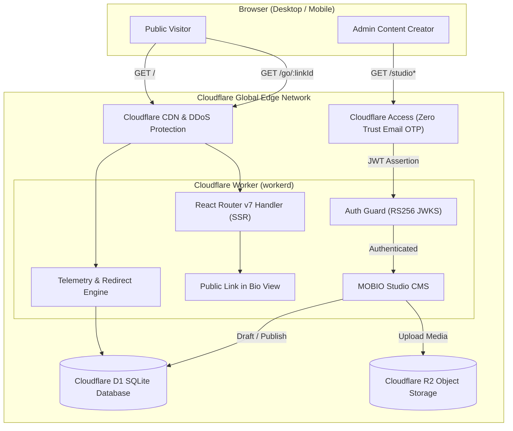
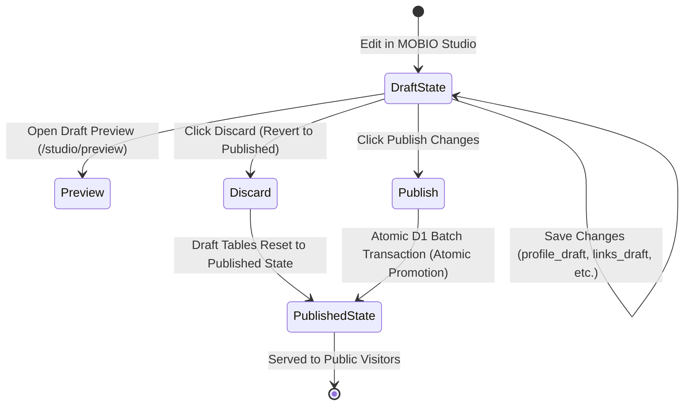

# Technical Architecture Specification

This document details the software architecture, data models, edge runtime integration, and security layers of **MOBIO Link Bio**.

---

## 📑 Table of Contents

1. [High-Level Architecture](#1-high-level-architecture)
2. [Edge Server-Side Rendering (SSR) Pipeline](#2-edge-server-side-rendering-ssr-pipeline)
3. [Zero Trust Security & Authentication](#3-zero-trust-security--authentication)
4. [Database & Content Isolation Architecture](#4-database--content-isolation-architecture)
5. [Media Storage & Delivery (Cloudflare R2)](#5-media-storage--delivery-cloudflare-r2)
6. [Privacy-First Telemetry Engine](#6-privacy-first-telemetry-engine)
7. [Internationalization (i18n) Engine](#7-internationalization-i18n-engine)
8. [Liquid Glass Design System](#8-liquid-glass-design-system)

---

## 1. High-Level Architecture

MOBIO Link Bio is engineered as a unified full-stack application deployed on Cloudflare Workers. It pairs React Router v7 with Cloudflare's serverless primitives (D1, R2, and Access).

---

## 2. Edge Server-Side Rendering (SSR) Pipeline

1. **Request Ingestion:** Incoming HTTP requests enter `workers/app.ts`, which wraps the React Router request handler.
2. **Context Extension:** Cloudflare Worker bindings (`env.DB`, `env.MEDIA_BUCKET`, `env.CF_ACCESS_*`) are passed directly into the React Router `AppLoadContext`.
3. **Route Loaders:**
   - In `app/routes/home.tsx`, loaders query published records from D1 in parallel via `Promise.all()`.
   - If D1 is unreachable or uninitialized, loaders gracefully fall back to default profile definitions in `app/data/profile.ts`.
4. **Streaming HTML Output:** `app/entry.server.tsx` executes `renderToReadableStream()` from `react-dom/server`. Semantic HTML streams to the browser with complete meta tags, OG cards, and inline SVG assets.
5. **Client Hydration:** `app/entry.client.tsx` hydrates interactive state (language switching, tab panels, lightbox modals) without causing hydration mismatch.
6. **Configuration Isolation & Deployment Safety:** `vite.config.ts` dynamically binds `wrangler.instance.json` when present (or prioritizes `process.env.WRANGLER_CONFIG`). Self-hosters use dedicated npm scripts (`npm run build:instance`, `npm run deploy:instance`, `npm run migrate:instance`) backed by an automated preflight guard (`scripts/preflight-instance.mjs`) that halts deployment if production identifiers or unconfigured placeholders are detected, completely isolating independent instances from the upstream production `wrangler.json`.

---

## 3. Zero Trust Security & Authentication

Administrative access to MOBIO Studio is safeguarded by **Cloudflare Access Zero Trust** and audited in `app/lib/auth.server.ts`:

- **Fail-Closed Design:** If Access configuration or JWT headers are absent, all administrative endpoints reject requests with HTTP 401/403.
- **RS256 Signature Verification:** Using the Web Crypto API (`crypto.subtle`), the Worker verifies the RSA signature of the incoming `Cf-Access-Jwt-Assertion` against public JWKS keys fetched directly from Cloudflare (`https://<teamName>.cloudflareaccess.com/cdn-cgi/access/certs`).
- **Audience & Issuer Claims:** The JWT `aud` claim is validated against `CF_ACCESS_AUD`, and `iss` is validated against `CF_ACCESS_TEAM_NAME`.
- **CSRF Origin Protection:** Mutations (`POST`, `PUT`, `DELETE`) enforce matching `Origin` or `Referer` headers.
- **Local Dev Isolation:** Local simulation bypass (`X-Mobio-Dev-Identity`) is strictly forbidden if the application is running in production, if Cloudflare Access variables are set, or if proxy forwarding headers are present.

---

## 4. Database & Content Isolation Architecture

MOBIO uses **Cloudflare D1** with a strict dual-state isolation model:

### Table Isolation Strategies:
- **Row-Level Isolation:** Used for singletons (`profile` and `appearance_settings`) via explicit `id = 'draft'` and `id = 'published'` rows.
- **Table-Level Isolation:** Used for collections (`links`/`links_draft`, `explore_items`/`explore_items_draft`, `contact_methods`/`contact_methods_draft`, `explore_categories`/`explore_categories_draft`, `explore_subcategories`/`explore_subcategories_draft`).
- **Atomic Transactions:** Publishing executes inside `db.batch([...])`, ensuring that partial updates never expose inconsistent states.

---

## 5. Media Storage & Delivery (Cloudflare R2)

Uploaded images (avatars, covers, custom icons, gallery photos) are stored in Cloudflare R2:

- **Upload Pipeline:** `POST /api/studio/media` generates a unique UUID, writes the object buffer to R2, and creates a metadata record in the `media_assets` table.
- **Public Delivery:** `GET /api/public/media/:id` reads from R2 with immutable caching (`Cache-Control: public, max-age=31536000, immutable`).
- **Authenticated Preview:** `GET /api/studio/media/:id/preview` verifies administrator authentication before streaming private draft media.

---

## 6. Privacy-First Telemetry Engine

MOBIO provides built-in link and visitor analytics without invasive trackers:

1. **Link Redirect Tracking:**
   - Public links route through `GET /go/:linkId`.
   - The handler records the click into `click_events` (storing only `link_id`, timestamp, and sanitized referrer).
   - Zero raw IP addresses, persistent cookies, or device fingerprinting are collected.
2. **Page Views vs. Actual Clicks:**
   - Page view telemetry (`page_views`) logs section views.
   - Explore and Contact clicks log to `interaction_events` only when users trigger actual clicks on item cards or contact methods.
   - The Click Monitor dashboard calculates **Total Interactions** strictly from actual click events, keeping page views separate.

---

## 7. Internationalization (i18n) Engine

Located at `app/lib/i18n.ts`:

- **Universal Default:** English (`en`).
- **Supported Languages:** English (`en`), Indonesian (`id`).
- **Hydration Synchronization:** The root document parses the `mobio_lang` cookie during SSR to render `<html lang="...">`. Dynamic switching updates `document.cookie`, `localStorage`, and `document.documentElement.lang` synchronously.
- **Content Fallbacks:** `getLocalizedText()` resolves localized fields with deterministic fallbacks:
  `Selected Language -> Alternative Language -> Safe Default String`.

---

## 8. Liquid Glass Design System

MOBIO's visual signature is built on atomic design tokens defined in `app/app.css` and computed in `app/lib/theme.ts`:

- **Translucent Refraction:** `backdrop-filter: blur(24px) saturate(180%)`.
- **Specular Edge Sheen:** `inset 0 1.5px 1px 0 rgba(255, 255, 255, 0.95)` on light themes, `inset 0 1.5px 1px 0 rgba(255, 255, 255, 0.15)` on dark themes.
- **Floating Shadow Architecture:** Layered elevation shadows (`0 8px 32px 0 rgba(0, 0, 0, 0.08)`).
- **Reduced Motion Support:** Background video and aurora animations pause automatically when `prefers-reduced-motion: reduce` is detected or when browser tabs lose focus.
